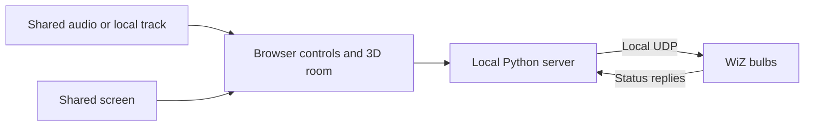

# WiZ Lighting Studio

A local smart-lighting dashboard that turns a model of a bedroom into a control surface for real WiZ bulbs. Built by [Aryaman Mittal](https://github.com/aryamanmittal24), with AI-assisted implementation and iteration against physical lights.

The project started with basic bulb control and grew into a browser-based studio for scenes, music and screen-driven lighting. The engineering challenge was making commands predictable over a noisy local Wi-Fi network while keeping manual controls responsive.

## What I built

- **Interactive 3D room:** select real fixtures, preview a scene, and apply it to the room. Orbiting the model or previewing a scene does not issue bulb commands.
- **Local bulb controller:** discovery, device-identity checks, connection recovery, per-light scenes and partial-failure reporting.
- **Music lighting:** browser audio analysis, beat-driven effects, optional acoustic timing calibration, and advance analysis of local song files.
- **Screen sync:** coordinated lighting based on browser-shared screen content.
- **Input integrations:** optional remote-button and health-data bridges, each requiring its own setup.

## How it fits together



## Run locally

```sh
python3 server.py
```

Open http://127.0.0.1:8765 and use Rescan to find bulbs on your network. Core bulb control uses Python's standard library. Advanced song analysis has optional dependencies in `requirements-analysis.txt`. Personal `settings.json`, tokens and OAuth client files are excluded.

See the [full usage and setup guide](docs/USER_GUIDE.md) for music capture, calibration, 3D scene controls and optional integrations.

## Engineering decisions and limits

A bulb address can change, so writes verify device identity rather than trusting an old IP. A manual command cancels effects that own the lights. Music commands expire to prevent delayed frames from replaying after a stall. Partial bulb failures are reported individually.

The 3D room is a visual control surface, not a measured lighting simulation. Wi-Fi latency, browser scheduling and Bluetooth buffering limit synchronization accuracy. Successful UDP dispatch does not prove the instant a bulb changed physically. Optical timing validation remains future work.

## Evidence and development history

- [Case study and development milestones](docs/CASE_STUDY.md)
- [Actual commits](https://github.com/aryamanmittal24/wiz-lighting/commits/main/) — open a commit to inspect its changes.
- [Roadmap](TODO.md) — proposals are separate from working features.

Publication checks: **35 focused Python tests passed on 15 November 2026**, covering the controller, music bridge, pattern frames and track API. These are software tests; they do not measure physical synchronization accuracy.

```sh
python3 -m unittest test_server test_music_bridge test_pattern_frames test_track_api
node test_music_sync.cjs
node test_screen_sync.cjs
```

The additional Node checks above are available for local verification; the publication count refers to the Python command.

## Attribution

Custom application and integration work by Aryaman Mittal, developed with AI assistance. Three.js and OrbitControls are vendored for offline use; their MIT license is retained in `web/vendor/THREE-LICENSE.txt`. This is an independent personal project, not an official WiZ product.
