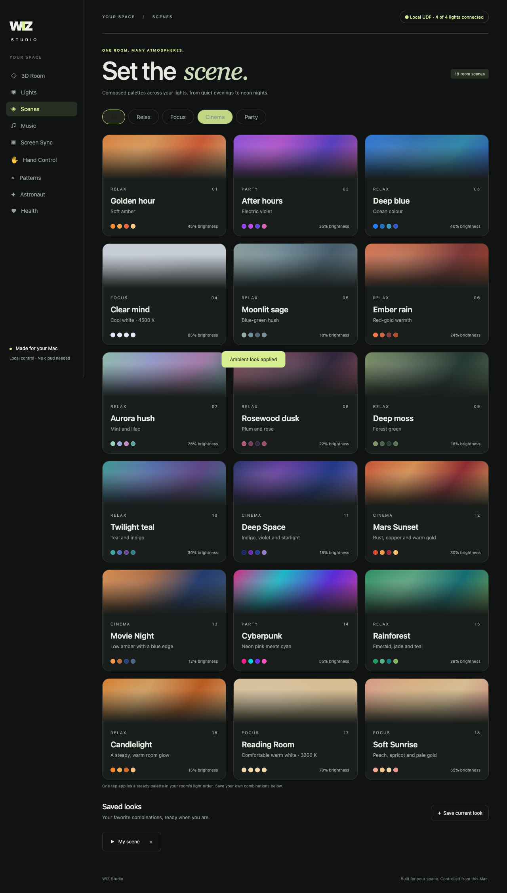
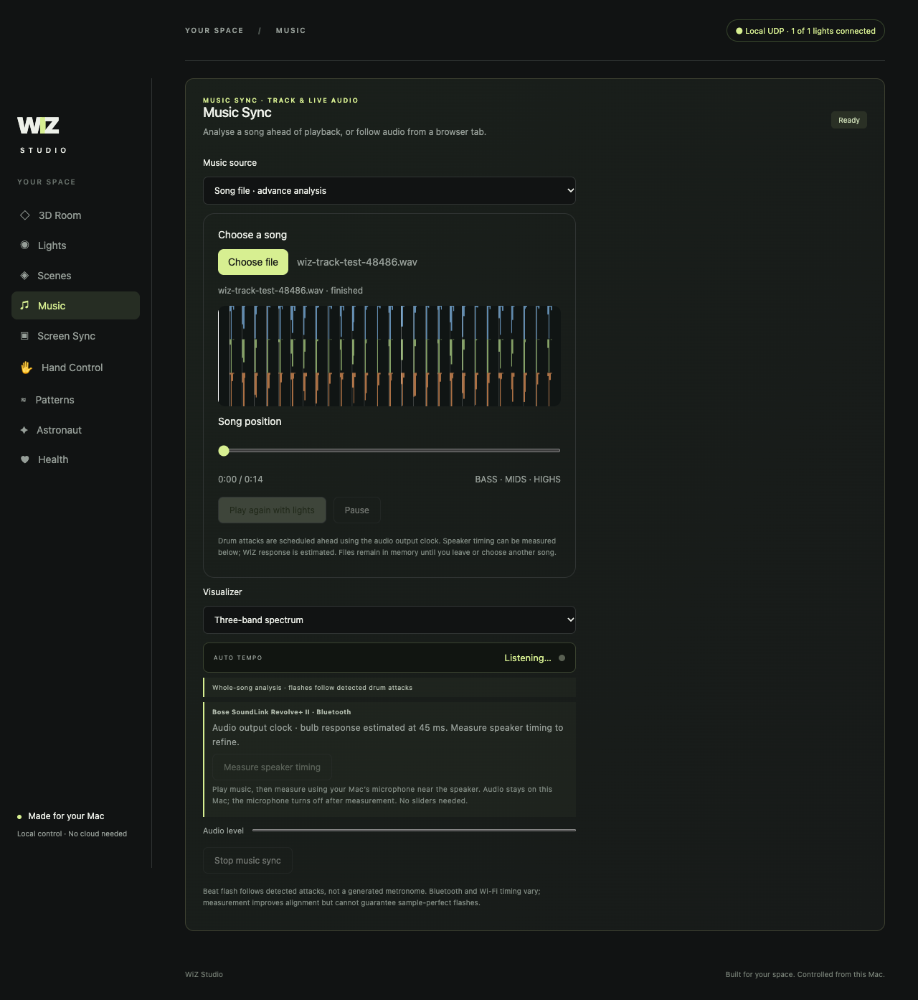
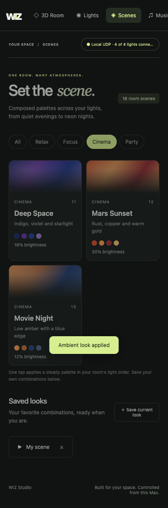
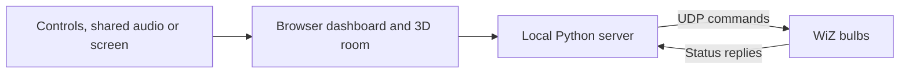

# WiZ Lighting Studio

**Four smart bulbs, a model of my room, and a project that kept growing.**

I started with a simple request: control my WiZ lights from my Mac. Then I wanted to click the lamps in a 3D version of my room. Then I wanted the lights to follow music, match the screen, and remember different moods. This is where those experiments ended up.

WiZ Studio is a local browser dashboard for controlling real WiZ bulbs, building room scenes, and experimenting with light as part of music and movies.

[Getting started](#try-it-yourself) · [Build story](docs/CASE_STUDY.md) · [Full guide](docs/USER_GUIDE.md) · [Commits](https://github.com/aryamanmittal24/wiz-lighting/commits/main/)


*The scene library: a way to change the feel of the whole room, with a different color and brightness for each light. This is a saved development screenshot of the application.*

## Why I made it

I already had the lights. I wanted to see how much more I could do with them using the hardware in my room and a bit of software.

A room layout felt more natural than a list of device names: click the floor lamp, change its color, see how it fits with the lights above the bed. Music and screen sync came from the same curiosity—could the room become part of what I was listening to or watching?

It became a practical way to learn about local device control, browser audio, 3D interfaces, and the gap between a command being sent and something actually happening in the room.

## What you can do

| Feature | What it does |
| --- | --- |
| **3D room controls** | Rotate a bedroom model, select fixtures, and control the matching bulbs. Preview a look before applying it. |
| **Scenes and saved looks** | Apply coordinated palettes or save each bulb's current color, brightness and power state. |
| **Music sync** | Follow audio shared from a browser tab, or analyze a local song ahead of playback to schedule lighting changes. |
| **Screen sync** | Use browser-shared screen content to drive ambient colors. |
| **Everyday controls** | Discover lights, rename them, set brightness, choose colors or white temperatures, and see connection failures. |
| **Optional experiments** | Remote-button input and health-data integration hooks, with their own hardware or account setup. |

### Music was where the timing got interesting


*Advance analysis of a short test track. This screenshot shows the UI and analysis workflow; it is not a measurement of physical bulb timing.*

Making lights flash is easy. Making them feel connected to a song is harder. I worked through beat detection, the difference between tempo and individual attacks, Bluetooth speaker delay, and commands arriving too late to be useful.

The project includes acoustic timing calibration and stale-frame handling, but synchronization is still approximate. Wi-Fi bulbs, browser scheduling and Bluetooth buffering all affect the result.

<details>
<summary>Mobile scene view</summary>



</details>

## The parts I cared about getting right

- **A manual control should win.** Changing a light manually cancels effects that are currently controlling it.
- **An old IP should not control the wrong device.** Commands check bulb identity before applying changes.
- **A preview should stay a preview.** Exploring the room or previewing a scene does not send light commands.
- **Failures should be visible.** If one bulb fails, the dashboard reports that instead of treating the whole room as successful.

The core lighting path runs locally. Optional Google Health integration uses Google's services and needs a separately configured OAuth client.



## Try it yourself

You need Python 3, a browser, and WiZ bulbs reachable on the same local network.

```sh
git clone https://github.com/aryamanmittal24/wiz-lighting.git
cd wiz-lighting
python3 server.py
```

Open **http://127.0.0.1:8765** and use **Rescan** to find your lights. The core controller uses Python's standard library. Advanced song analysis uses the optional packages in `requirements-analysis.txt`; see the [setup guide](docs/USER_GUIDE.md).

The 3D model reflects my room, so fixture assignments and the layout may need adapting for yours. Device settings are created locally. Passwords, OAuth tokens and private configuration are not included.

## What I learned—and what is unfinished

The most useful lesson was that a good interface needs to account for unreliable hardware and timing, not just offer more controls. A UDP command being dispatched does not prove when a bulb changed. A pretty 3D preview does not measure how bright a room will be.

The next useful step is measuring physical light response and improving timing from that evidence. Games and other hardware ideas are listed in the [roadmap](TODO.md); they are plans, not finished features.

**Verification:** 35 focused Python tests passed in the publication run on 15 November 2026. They cover controller behavior, the music bridge, pattern frames and the track API. They do not establish physical timing accuracy.

```sh
python3 -m unittest test_server test_music_bridge test_pattern_frames test_track_api
```

More browser and Node test harnesses are included in the repository.

## About the work

I chose the hardware and features, supplied the room references, tested the lights, and iterated on what felt useful. I used AI assistance for implementation and debugging. The [case study](docs/CASE_STUDY.md) explains the development stages and tradeoffs; the [commit history](https://github.com/aryamanmittal24/wiz-lighting/commits/main/) records the actual publication changes. Earlier local work was uploaded as a snapshot.

Three.js and OrbitControls are included with their [MIT license](web/vendor/THREE-LICENSE.txt). This is a personal project, independent of WiZ and Signify.

**Related experiment:** [RuView Bedroom](https://github.com/aryamanmittal24/ruview-bedroom)—exploring what Wi-Fi signals can tell me about activity in the same room.
